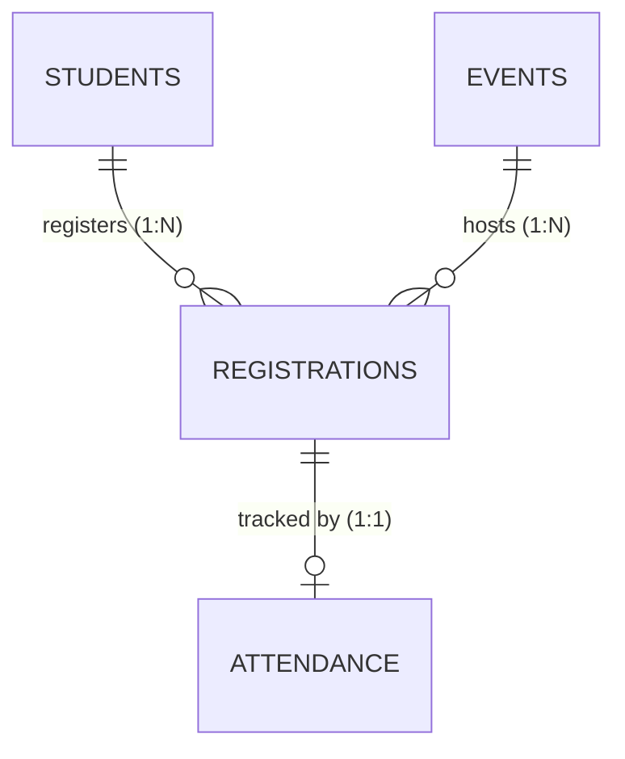
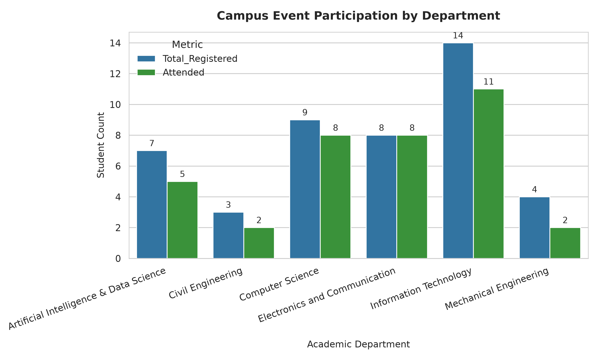
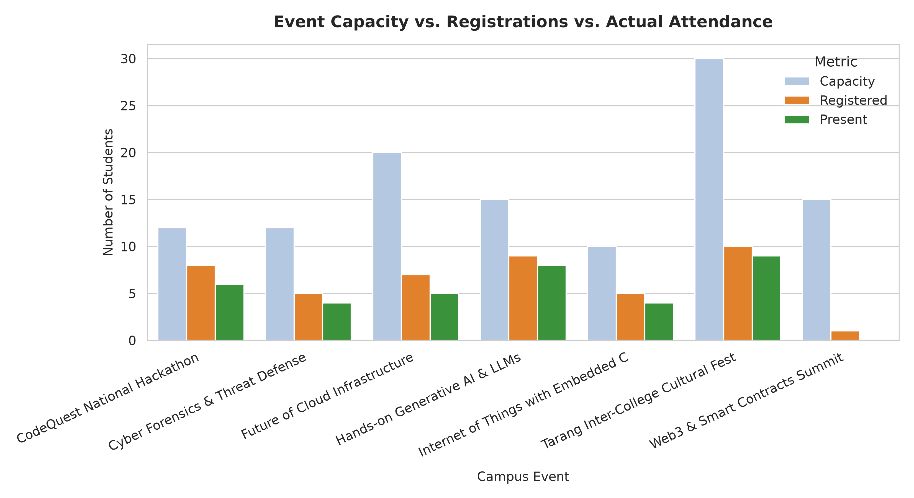
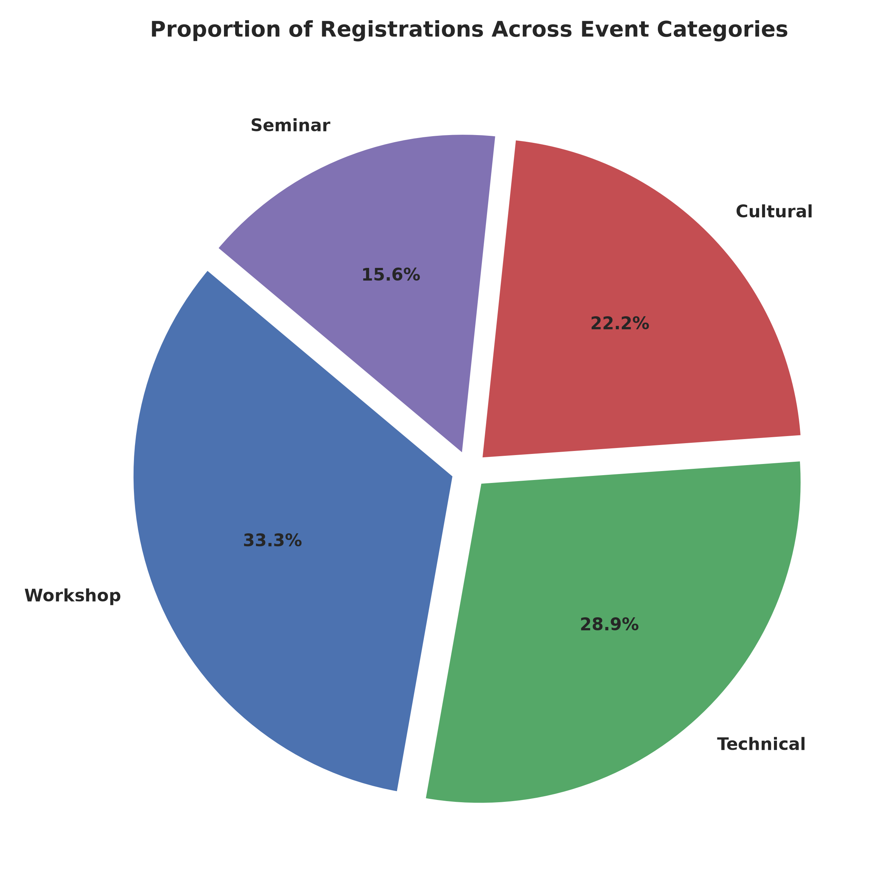
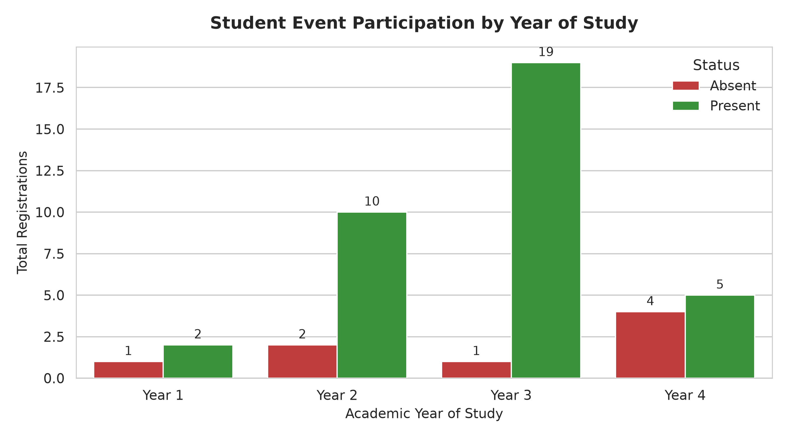
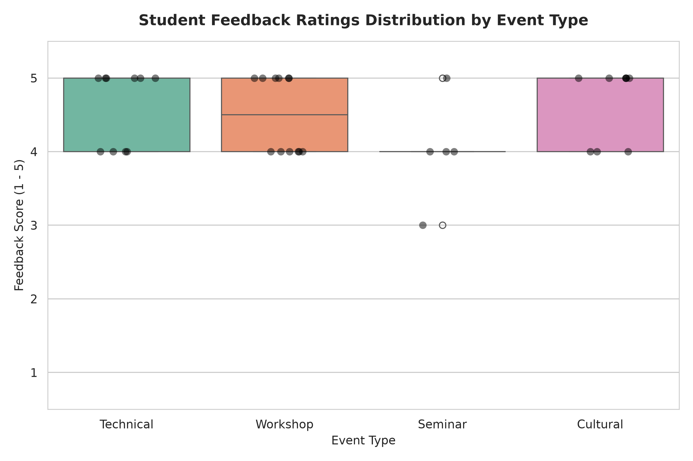
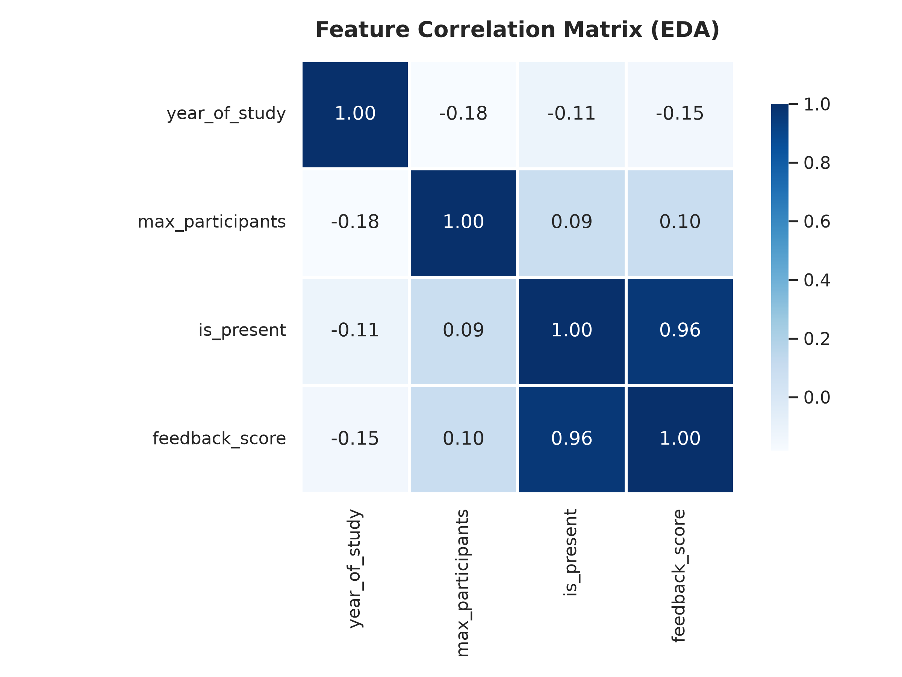

# Smart Campus Event Management and Student Participation Analysis System

<p align="center">
  <b>VELALAR COLLEGE OF ENGINEERING AND TECHNOLOGY (AUTONOMOUS), ERODE – 12</b><br>
  <b>DEPARTMENT OF INFORMATION TECHNOLOGY</b><br>
  <b>ACADEMIC YEAR: 2026-27 (ODD SEMESTER) | CLASS: 25IT3A & 25IT3B</b><br>
  <b>ACTIVITY: PROJECT-BASED ASSESSMENT</b><br>
  <b>SCENARIO 6 (Register Numbers: 06, 36, 66, 96)</b>
</p>

<p align="center">
  <a href="https://ahashkk6-ctrl.github.io/Students-Event-Management/"></a>
  <a href="https://github.com/ahashkk6-ctrl/Students-Event-Management"></a>
</p>

### 🌐 Live Web Application Access:
**Live Link**: **[https://ahashkk6-ctrl.github.io/Students-Event-Management/](https://ahashkk6-ctrl.github.io/Students-Event-Management/)**

---

## 📋 Table of Contents
- [Project Overview](#-project-overview)
- [Problem Statement](#-problem-statement)
- [Functional Requirements](#-functional-requirements)
- [Course Curriculum Alignment](#-course-curriculum-alignment)
- [Technology Stack](#-technology-stack)
- [Project Directory Structure](#-project-directory-structure)
- [Database Design & Setup](#-database-design--setup)
- [Step-by-Step Execution Guide](#-step-by-step-execution-guide)
  - [1. Database Initialization](#1-database-initialization)
  - [2. Java Application Compilation & Execution](#2-java-application-compilation--execution)
  - [3. Python Data Science & Visualization Pipeline](#3-python-data-science--visualization-pipeline)
  - [4. Jupyter Notebook Interactive EDA](#4-jupyter-notebook-interactive-eda)
- [Data Visualizations Gallery](#-data-visualizations-gallery)
- [Software Testing & Validation Summary](#-software-testing--validation-summary)
- [Deliverables Checklist](#-deliverables-checklist)

---

## 🎯 Project Overview
Colleges organize a multitude of technical events, workshops, hackathons, guest seminars, and cultural festivals throughout the academic year. When managed through manual registers or detached spreadsheets, institutions face recurring challenges:
- Accidental duplicate student registrations for the same event.
- Exceeding hall and computer laboratory maximum seat capacities.
- Cumbersome paper-based attendance tracking.
- Significant administrative delays in preparing participation summaries for accreditation (NAAC/NBA).

The **Smart Campus Event Management and Student Participation Analysis System** provides an automated, end-to-end digital solution developed using **Java**, **Relational Database Management Systems (DBMS / SQLite)**, and **Python (Foundations of Data Science)**.

---

## 📝 Problem Statement
*(From VCET IT Dept Scenario 6)*:
> "A college organizes various technical events, workshops, seminars, and cultural activities throughout the academic year. Managing event details, student registrations, attendance, and participation records manually can lead to duplicate registrations, difficulty tracking attendance, and delays in preparing reports.  
> The college requires a Smart Campus Event Management and Student Participation Analysis System to manage events, record student registrations and attendance, and analyze student participation patterns. Develop the system using Java, DBMS, and Python."

---

## ⚙️ Functional Requirements

| Requirement | Description | System Implementation |
| :--- | :--- | :--- |
| **FR 1** | **Maintain student details** (ID, name, department, year of study, contact). | `Student.java`, `StudentDAO.java`, SQL `students` table. |
| **FR 2** | **Add and manage event details** (ID, name, category, date, venue, max capacity). | `Event.java`, `EventDAO.java`, SQL `events` table with `CHECK(max_participants > 0)`. |
| **FR 3** | **Allow event registration & prevent duplicate registrations**. | `EventService.java` enforces duplicate verification; SQL compound constraint `UNIQUE(student_id, event_id)` rejects duplicate enrollments. Capacity threshold strictly guarded. |
| **FR 4** | **Record student attendance and participation status**. | `AttendanceDAO.java`, records `Present`/`Absent` status, 1–5 feedback score, and remarks. |
| **FR 5** | **Display registered participants & generate event-wise reports**. | Real-time participant listings and aggregated summary reports (total registered, present, absent, attendance %, avg rating). |
| **FR 6** | **Retrieve data, preprocess, and generate visualizations using Python**. | `analysis.py` queries SQLite, cleans data, computes metrics, and produces 6 high-res statistical charts using Matplotlib and Seaborn. |

---

## 🎓 Course Curriculum Alignment

This project integrates concepts across four core Information Technology courses:

1. **25ITT31 – Database Management Systems**:
   - Entity-Relationship (ER) model and Relational Schema design.
   - Normalization from UNF $\to$ 1NF $\to$ 2NF $\to$ 3NF $\to$ BCNF.
   - Advanced SQL: DDL, DML, composite unique constraints, foreign keys with cascade rules, analytical views, and B-Tree indexing.
2. **25ITT32 – Java Programming**:
   - Object-Oriented Programming (encapsulation, abstraction, inheritance).
   - Java Collections Framework (`List`, `ArrayList`), Exception Handling (`try-catch-finally`).
   - Java Database Connectivity (JDBC) utilizing `PreparedStatement` to eliminate SQL injection.
3. **25ITT33 – Software Engineering**:
   - Complete Software Requirements Specification (SRS) based on IEEE Std 830-1998.
   - UML Diagrams: Overall System Architecture, Use Case Diagram, Class Diagram, and Sequence Diagram.
   - Software Testing: Black-Box (Equivalence Partitioning, Boundary Value Analysis) and White-Box (Branch Coverage) test cases.
4. **25ITC31 – Foundations of Data Science**:
   - Python database ingestion using `sqlite3` and `pandas`.
   - Data cleaning, missing value imputation, duplicate verification, and derived metric engineering.
   - Statistical visualizations: Grouped Bar Charts, Pie Charts, Count Plots, Box Plots, and Correlation Heatmaps using `matplotlib` and `seaborn`.

---

## 🛠️ Technology Stack
- **Programming Languages**: Java 21 (LTS), Python 3.11+
- **Database Engine**: SQLite 3 (Zero-configuration serverless RDBMS)
- **Database Connectivity**: SQLite JDBC Driver (`sqlite-jdbc`)
- **Data Science Libraries**: Pandas, NumPy, Matplotlib, Seaborn
- **Development Tooling**: Apache Maven, Windows PowerShell, Visual Studio Code

---

## 📂 Project Directory Structure

```
Student Event Management/
│
├── database/                            # Database SQL scripts
│   ├── schema.sql                       # Table definitions, constraints, indexes & views
│   ├── sample_data.sql                  # 20+ students, 6 events, 44 registrations & attendance records
│   └── queries.sql                      # Reporting, aggregation, and subqueries
│
├── src/com/smartcampus/                 # Java Source Code
│   ├── model/                           # Domain entities
│   │   ├── Student.java                 # Student model
│   │   ├── Event.java                   # Event model
│   │   ├── Registration.java            # Registration model
│   │   ├── Attendance.java              # Attendance & feedback model
│   │   └── EventReport.java             # Aggregated reporting DTO
│   ├── dao/                             # Data Access Layer (JDBC)
│   │   ├── StudentDAO.java              # Student CRUD
│   │   ├── EventDAO.java                # Event CRUD & capacity counts
│   │   ├── RegistrationDAO.java         # Registration & duplicate checks
│   │   ├── AttendanceDAO.java           # Attendance & rating marking
│   │   └── ReportDAO.java               # Aggregated analytics
│   ├── service/                         # Business Logic Layer
│   │   └── EventService.java            # Validations, duplicate guard, capacity limits
│   ├── util/                            # Utilities
│   │   ├── DBConnection.java            # Connection singleton & auto-setup
│   │   └── ConsoleHelper.java           # ANSI formatting & input helpers
│   └── Main.java                        # Interactive application console entry point
│
├── data_analysis/                       # Python Data Science Module
│   ├── analysis.py                      # Preprocessing & visualization script
│   ├── student_event_analysis.ipynb     # Jupyter Notebook with step-by-step EDA
│   ├── preprocessed_participation_data.csv # Exported clean analytical dataset
│   └── visualizations/                  # High-resolution generated charts
│       ├── 01_department_participation_barchart.png
│       ├── 02_event_attendance_comparison.png
│       ├── 03_event_type_distribution_piechart.png
│       ├── 04_year_wise_participation_countplot.png
│       ├── 05_feedback_rating_boxplot.png
│       └── 06_participation_correlation_heatmap.png
│
├── docs/                                # Software Engineering & Academic Documentation
│   ├── SRS.md                           # IEEE Std 830-1998 Requirements Specification
│   ├── System_Architecture.md           # Architecture, Use Case, Class & Sequence Diagrams
│   ├── Database_Design.md               # ER Diagram, Relational Model & Normalization Proofs
│   └── Testing_Report.md                # Test techniques, strategies & 15 test cases
│
├── sample_outputs/                      # Execution logs & transcripts
│   ├── SAMPLE_INPUTS_AND_OUTPUTS.md     # Documented sample inputs and outputs
│   └── cli_execution_log.txt            # Real interactive CLI run transcript
│
├── lib/                                 # Required Java runtime libraries
│   ├── sqlite-jdbc.jar                  # SQLite JDBC driver
│   ├── slf4j-api.jar                    # Logging interface
│   ├── logback-classic.jar              # Logging implementation
│   └── logback-core.jar                 # Core logging support
│
├── smart_campus.db                      # Live SQLite relational database
├── run_app.bat                          # One-click Windows application launcher
└── README.md                            # Comprehensive project guide (this document)
```

---

## 🗄️ Database Design & Setup

The database schema enforces 3NF and BCNF normalization:
- **`students`**: Stores student profiles identified by unique `student_id`.
- **`events`**: Stores campus event schedules, categories, venues, and `max_participants`.
- **`registrations`**: Associative entity linking students to events. Enforces `CONSTRAINT uq_student_event UNIQUE (student_id, event_id)` to **prevent duplicate registrations**.
- **`attendance`**: Tracks `Present` / `Absent` status, feedback scores (1 to 5), and qualitative remarks for each registration.



---

## 🚀 Step-by-Step Execution Guide

### 1. Database Initialization
The database `smart_campus.db` is already pre-configured. To re-initialize or reset the database at any time, run:
```powershell
python -c "
import sqlite3
conn = sqlite3.connect('smart_campus.db')
with open('database/schema.sql', 'r', encoding='utf-8') as f:
    conn.executescript(f.read())
with open('database/sample_data.sql', 'r', encoding='utf-8') as f:
    conn.executescript(f.read())
conn.commit()
conn.close()
print('Database initialized successfully!')
"
```

### 2. Java Application Compilation & Execution

#### Option A: Interactive Command-Line Console (CLI)
To run the interactive CLI application:
```powershell
java -cp "bin;lib/*" com.smartcampus.Main
```
*(Or double-click `run_app.bat` on Windows).*

#### Option B: Modern Desktop Graphical User Interface (Swing GUI)
To launch the full desktop window with tabs for Students, Events, Registration, Attendance, and Reports:
```powershell
start javaw -cp "bin;lib/*" com.smartcampus.gui.SmartCampusGUI
```
*(Or double-click `run_gui.bat` on Windows).*

#### Option C: Build and Run via Maven
```powershell
mvn clean compile
mvn exec:java -Dexec.mainClass="com.smartcampus.Main"
```

### 3. Python Data Science & Visualization Pipeline
To execute the database retrieval, data preprocessing, and chart generation:
```powershell
python data_analysis/analysis.py
```
This script will output summary statistics and save 6 high-resolution charts in `data_analysis/visualizations/`.

### 4. Jupyter Notebook Interactive EDA
To explore the dataset interactively:
```powershell
jupyter notebook data_analysis/student_event_analysis.ipynb
```

---

## 📊 Data Visualizations Gallery

The following charts are automatically generated from the live database:

### 1. Department-Wise Event Participation
Comparison between total student registrations and actual event attendees across engineering departments.


### 2. Event Capacity vs. Registrations vs. Attendance
Evaluation of capacity utilization and actual attendance for each campus event.


### 3. Event Type Distribution
Proportion of campus activities across Technical events, Workshops, Seminars, and Cultural festivals.


### 4. Year of Study Participation Breakdown
Analysis of student engagement by academic seniority (Year 1 to Year 4).


### 5. Student Feedback Score Distribution
Box plot illustrating student satisfaction ratings (1 to 5 scale) by event category.


### 6. Feature Correlation Matrix (EDA)
Correlation heatmap analyzing relationships between year of study, event capacity, attendance status, and feedback scores.


---

## 🧪 Software Testing & Validation Summary

A comprehensive test suite of **15 test cases** was designed and executed following Software Engineering principles (Unit, Integration, Black-Box Equivalence Partitioning, Boundary Value Analysis, and White-Box Branch Testing):

- **15 / 15 Test Cases Passed (100% Pass Rate)**.
- **Duplicate Prevention Verification**: Attempting to register an already-registered student ID returns:  
  `[WARNING] [PREVENTED DUPLICATE] Student is already registered for this event.`
- **Capacity Overflow Verification**: Registering past maximum capacity is safely rejected.
- Full testing details are documented in [docs/Testing_Report.md](file:///c:/Users/AKSHATHA/OneDrive/Desktop/Student%20Event%20Management/docs/Testing_Report.md).

---

## ✅ Deliverables Checklist

- [x] **1. SRS, Design Diagrams, and Testing Documents**:
  - [docs/SRS.md](file:///c:/Users/AKSHATHA/OneDrive/Desktop/Student%20Event%20Management/docs/SRS.md) (IEEE 830 Standard)
  - [docs/System_Architecture.md](file:///c:/Users/AKSHATHA/OneDrive/Desktop/Student%20Event%20Management/docs/System_Architecture.md) (Architecture, Use Case, Class, Sequence Diagrams)
  - [docs/Testing_Report.md](file:///c:/Users/AKSHATHA/OneDrive/Desktop/Student%20Event%20Management/docs/Testing_Report.md) (15 Test Cases with Expected vs. Actual results)
- [x] **2. Java Source Code, Sample Inputs, and Outputs**:
  - Full modular Java code under [src/com/smartcampus/](file:///c:/Users/AKSHATHA/OneDrive/Desktop/Student%20Event%20Management/src/com/smartcampus/)
  - Sample inputs and outputs documented in [sample_outputs/SAMPLE_INPUTS_AND_OUTPUTS.md](file:///c:/Users/AKSHATHA/OneDrive/Desktop/Student%20Event%20Management/sample_outputs/SAMPLE_INPUTS_AND_OUTPUTS.md) and [sample_outputs/cli_execution_log.txt](file:///c:/Users/AKSHATHA/OneDrive/Desktop/Student%20Event%20Management/sample_outputs/cli_execution_log.txt)
- [x] **3. ER Diagram, Relational Model, SQL Scripts, and Normalization Details**:
  - [docs/Database_Design.md](file:///c:/Users/AKSHATHA/OneDrive/Desktop/Student%20Event%20Management/docs/Database_Design.md) (ER diagram, relational model, 1NF to BCNF normalization)
  - [database/schema.sql](file:///c:/Users/AKSHATHA/OneDrive/Desktop/Student%20Event%20Management/database/schema.sql) (DDL, constraints, indexes, views)
  - [database/sample_data.sql](file:///c:/Users/AKSHATHA/OneDrive/Desktop/Student%20Event%20Management/database/sample_data.sql) (Comprehensive seed data)
  - [database/queries.sql](file:///c:/Users/AKSHATHA/OneDrive/Desktop/Student%20Event%20Management/database/queries.sql) (Complex queries, aggregations, joins)
- [x] **4. Python Code for Database Retrieval, Preprocessing, and Visualizations**:
  - [data_analysis/analysis.py](file:///c:/Users/AKSHATHA/OneDrive/Desktop/Student%20Event%20Management/data_analysis/analysis.py) (Database query, data wrangling, 6 charts)
  - [data_analysis/student_event_analysis.ipynb](file:///c:/Users/AKSHATHA/OneDrive/Desktop/Student%20Event%20Management/data_analysis/student_event_analysis.ipynb) (Interactive Jupyter Notebook)
  - High-res chart PNGs in [data_analysis/visualizations/](file:///c:/Users/AKSHATHA/OneDrive/Desktop/Student%20Event%20Management/data_analysis/visualizations/)
- [x] **5. README.md File**:
  - Comprehensive project guide with architecture, execution steps, and visual gallery.
