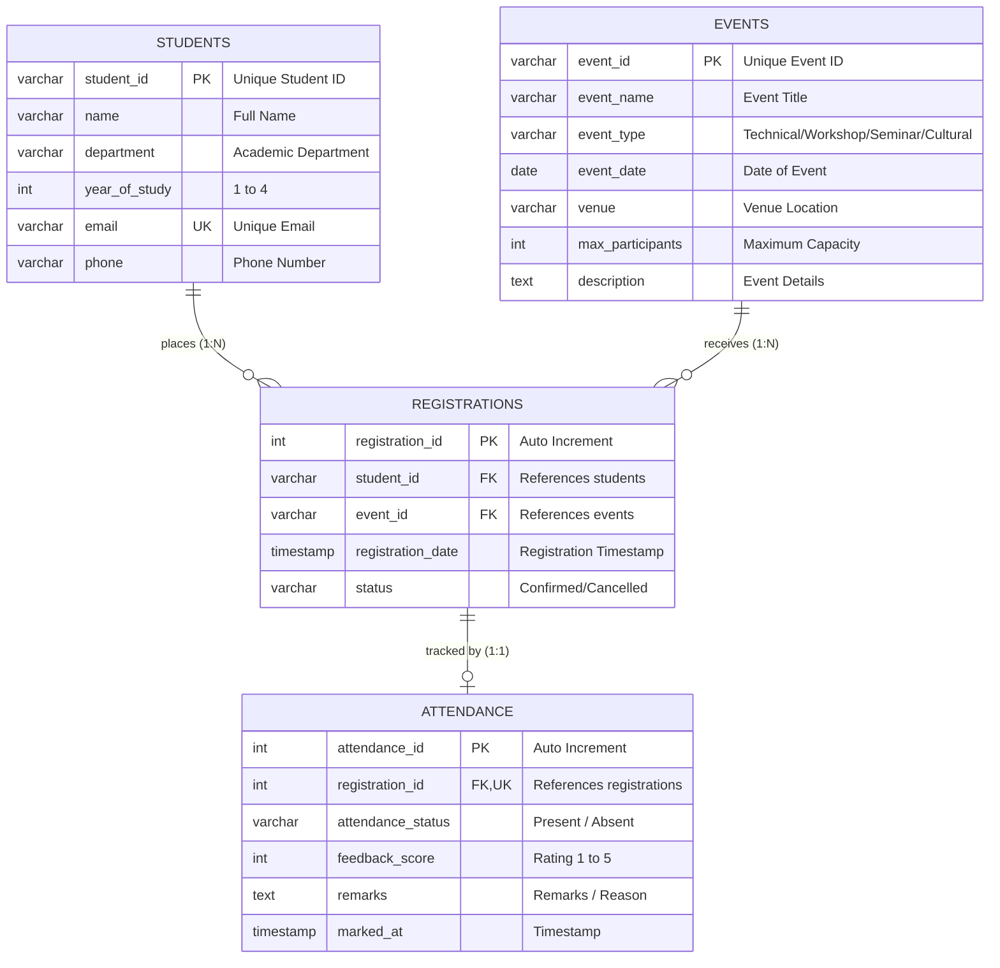

# DATABASE DESIGN, ER MODEL, AND NORMALIZATION REPORT
## Smart Campus Event Management and Student Participation Analysis System

**Institution**: Velalar College of Engineering and Technology (Autonomous), Erode – 638012  
**Department**: Department of Information Technology  
**Course Code & Title**: 25ITT31 – Database Management Systems (Units 1, 2, 3, 4)  
**Academic Year**: 2026-27 (ODD Semester)  
**Scenario**: Scenario 6 (Smart Campus Event Management and Participation Analysis)  

---

## 1. Entity-Relationship (ER) Model

The database represents college campus events, student enrollments, attendance verification, and feedback metrics. 

### 1.1 Identified Entities & Attributes
1. **Student** (Strong Entity)
   - `student_id` (PK, Alphanumeric string, e.g., '25IT001')
   - `name` (String, student's full name)
   - `department` (String, academic department)
   - `year_of_study` (Integer, 1 to 4)
   - `email` (String, unique institutional email)
   - `phone` (String, contact telephone)

2. **Event** (Strong Entity)
   - `event_id` (PK, Alphanumeric code, e.g., 'EVT101')
   - `event_name` (String, title of the event)
   - `event_type` (String, Technical / Workshop / Seminar / Cultural)
   - `event_date` (Date, ISO YYYY-MM-DD)
   - `venue` (String, room/lab location)
   - `max_participants` (Integer, strictly positive capacity limit)
   - `description` (Text, summary of the event)

3. **Registration** (Associative Entity resolving Many-to-Many M:N relationship between Student and Event)
   - `registration_id` (PK, Integer Auto-increment)
   - `student_id` (FK referencing `students.student_id`)
   - `event_id` (FK referencing `events.event_id`)
   - `registration_date` (Timestamp)
   - `status` (String, 'Confirmed', 'Cancelled', 'Waitlisted')
   - **Constraint**: `UNIQUE(student_id, event_id)` enforces duplicate prevention.

4. **Attendance** (Entity tracking participation and evaluation)
   - `attendance_id` (PK, Integer Auto-increment)
   - `registration_id` (FK referencing `registrations.registration_id`, UNIQUE)
   - `attendance_status` (String, 'Present' or 'Absent')
   - `feedback_score` (Integer, 1 to 5)
   - `remarks` (Text, participant remarks or absence reason)
   - `marked_at` (Timestamp)

### 1.2 ER Diagram (Crow's Foot Notation)

---

## 2. Relational Schema & Integrity Constraints

The relational model is represented by the following relational schemas:

- $\text{STUDENTS}(\underline{\text{student\_id}}, \text{name}, \text{department}, \text{year\_of\_study}, \text{email}, \text{phone})$
- $\text{EVENTS}(\underline{\text{event\_id}}, \text{event\_name}, \text{event\_type}, \text{event\_date}, \text{venue}, \text{max\_participants}, \text{description})$
- $\text{REGISTRATIONS}(\underline{\text{registration\_id}}, \text{student\_id}^*, \text{event\_id}^*, \text{registration\_date}, \text{status})$
  - Foreign Key: $\text{student\_id} \rightarrow \text{STUDENTS}(\text{student\_id})$
  - Foreign Key: $\text{event\_id} \rightarrow \text{EVENTS}(\text{event\_id})$
  - Candidate Key / Unique Constraint: $(\text{student\_id}, \text{event\_id})$
- $\text{ATTENDANCE}(\underline{\text{attendance\_id}}, \text{registration\_id}^*, \text{attendance\_status}, \text{feedback\_score}, \text{remarks}, \text{marked\_at})$
  - Foreign Key: $\text{registration\_id} \rightarrow \text{REGISTRATIONS}(\text{registration\_id})$
  - Unique Constraint: $\text{registration\_id}$

---

## 3. Database Normalization Walkthrough (Unit 3)

### 3.1 Initial Unnormalized Form (UNF)
In a traditional spreadsheet, student details, event details, registration timestamps, attendance status, and feedback ratings are clumped into a single unnormalized relation:

$$\text{UNF\_RECORD}(\text{student\_id}, \text{name}, \text{dept}, \text{year}, \{\text{event\_id}, \text{event\_name}, \text{type}, \text{venue}, \text{att\_status}, \text{feedback}\})$$

- **Anomalies in UNF**:
  - **Insertion Anomaly**: Cannot add a new event until a student registers for it.
  - **Deletion Anomaly**: Deleting a student's record deletes the event's historical record if they were the sole participant.
  - **Update Anomaly**: Changing an event venue requires updating numerous duplicate rows.

### 3.2 Conversion to First Normal Form (1NF)
- **Requirement**: A relation is in 1NF if and only if all underlying domains contain only atomic (indivisible) values and there are no repeating groups.
- **Action**: Flatten repeating event records into discrete rows and identify a candidate composite primary key: $(\text{student\_id}, \text{event\_id})$.
- **Resulting 1NF Relation**:
  $$\text{FLAT\_REGISTRATION}(\underline{\text{student\_id}}, \underline{\text{event\_id}}, \text{name}, \text{dept}, \text{year}, \text{event\_name}, \text{type}, \text{venue}, \text{att\_status}, \text{feedback})$$

### 3.3 Conversion to Second Normal Form (2NF)
- **Requirement**: A relation is in 2NF if it is in 1NF and no non-prime attribute is partially dependent on any candidate key (no partial dependencies: $X \to Y$ where $X \subset \text{Key}$).
- **Analysis of Functional Dependencies (FDs)**:
  - $FD_1: \text{student\_id} \to \text{name}, \text{dept}, \text{year}, \text{email}, \text{phone}$ *(Partial dependency on composite key)*
  - $FD_2: \text{event\_id} \to \text{event\_name}, \text{event\_type}, \text{venue}, \text{max\_participants}$ *(Partial dependency on composite key)*
  - $FD_3: (\text{student\_id}, \text{event\_id}) \to \text{registration\_date}, \text{status}$ *(Full dependency)*
  - $FD_4: \text{registration\_id} \to \text{att\_status}, \text{feedback}, \text{remarks}$
- **Action**: Decompose into independent tables removing partial dependencies:
  - $\text{STUDENTS}(\underline{\text{student\_id}}, \dots)$
  - $\text{EVENTS}(\underline{\text{event\_id}}, \dots)$
  - $\text{REGISTRATIONS}(\underline{\text{student\_id}, \text{event\_id}}, \text{registration\_date}, \text{status})$

### 3.4 Conversion to Third Normal Form (3NF)
- **Requirement**: A relation is in 3NF if it is in 2NF and there are no transitive dependencies ($X \to Y$ and $Y \to Z$ where neither $Y$ nor $Z$ is a candidate key).
- In our decomposed relations:
  - In $\text{STUDENTS}$, non-key attributes ($\text{name}, \text{dept}, \text{year}$) depend strictly on the primary key $\text{student\_id}$.
  - In $\text{EVENTS}$, non-key attributes depend strictly on $\text{event\_id}$.
  - In $\text{REGISTRATIONS}$, registration details depend strictly on $\text{registration\_id}$.
  - In $\text{ATTENDANCE}$, attendance details depend strictly on $\text{attendance\_id}$.
- All relations satisfy 3NF.

### 3.5 Boyce-Codd Normal Form (BCNF)
- **Requirement**: A relation is in BCNF if for every non-trivial functional dependency $X \to Y$, $X$ is a **superkey**.
- Verification:
  - For $\text{STUDENTS}$: The only determinant is $\text{student\_id}$ (and unique candidate key $\text{email}$), both of which are superkeys.
  - For $\text{EVENTS}$: The only determinant is $\text{event\_id}$, which is a superkey.
  - For $\text{REGISTRATIONS}$: The determinants are $\text{registration\_id}$ and candidate key $(\text{student\_id}, \text{event\_id})$, both superkeys.
  - For $\text{ATTENDANCE}$: The determinant is $\text{attendance\_id}$ and candidate key $\text{registration\_id}$, both superkeys.
- **Conclusion**: The schema rigorously adheres to **BCNF**.

---

## 4. Query Optimization & Indexing Strategy (Unit 3)

To ensure sub-millisecond retrieval across large datasets:
- **Index on Foreign Keys**: `idx_registration_student` and `idx_registration_event` accelerate `JOIN` lookups between students, registrations, and events.
- **Index on Filter Attributes**: `idx_student_department`, `idx_student_year`, and `idx_event_date` ensure $O(\log N)$ B-Tree index scans during reporting and aggregations.
- **Analytical View**: `vw_event_participation_summary` encapsulates multi-table join logic, improving developer productivity and query maintainability.
