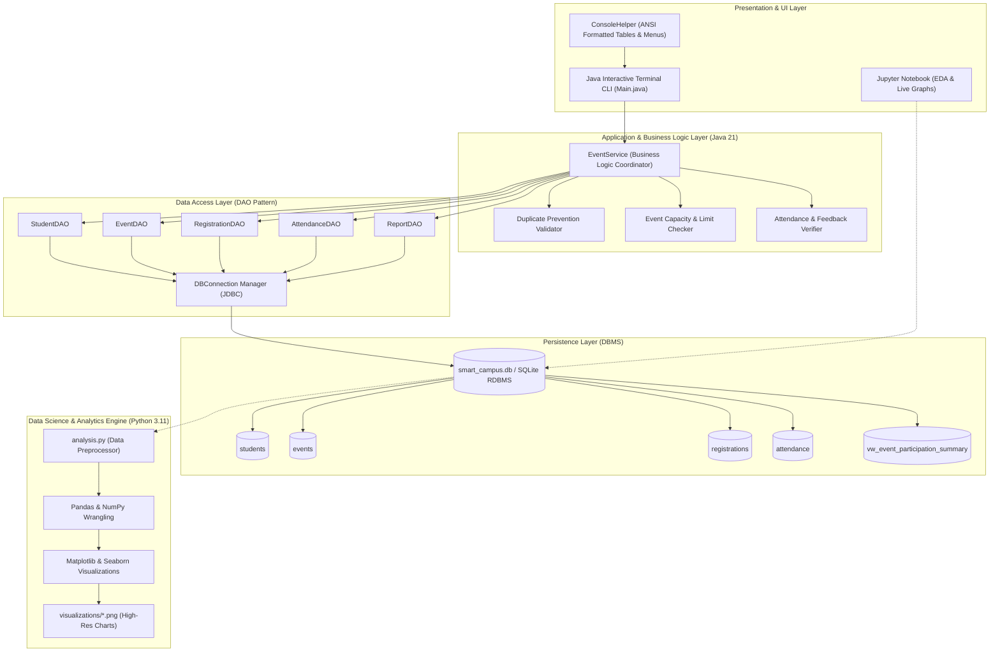
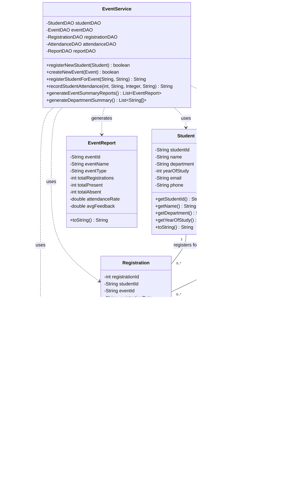
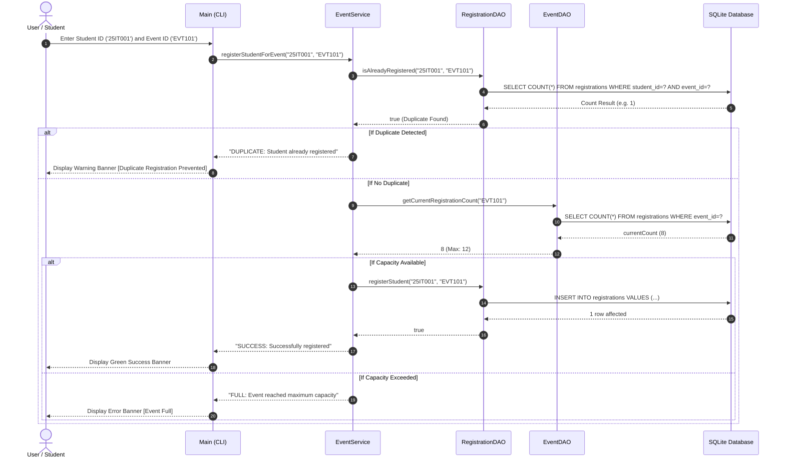

# SYSTEM ARCHITECTURE AND DESIGN DIAGRAMS
## Smart Campus Event Management and Student Participation Analysis System

**Institution**: Velalar College of Engineering and Technology (Autonomous), Erode – 638012  
**Department**: Department of Information Technology  
**Courses Integrated**: 25ITT32 (Java Programming) & 25ITT33 (Software Engineering)  
**Activity**: Activity-Project-Based Assessment  

---

## 1. Overall System Architecture

The Smart Campus Event Management System is architected as an enterprise multi-tier decoupled system comprising a **Presentation Layer**, a **Business Logic & Service Layer**, a **Persistence / Database Layer**, and a **Data Science & Analytics Layer**.



---

## 2. UML Use Case Diagram

The Use Case Diagram defines the interactions between the system actors (**Student**, **Event Coordinator / Faculty**, and **Department Head / Administrator**) and the system functions.

```mermaid
flowchart LR
    Student((Student))
    Coordinator((Event Coordinator / Faculty))
    Admin((HOD / Administrator))

    subgraph System_Boundary ["Smart Campus Event System"]
        UC1(["Browse Upcoming Events & Capacity"])
        UC2(["Register for Event"])
        UC3(["Prevent Duplicate Registration <<include>>"])
        UC4(["Enforce Maximum Capacity <<include>>"])
        UC5(["Add New Campus Event"])
        UC6(["Mark Student Attendance & Feedback"])
        UC7(["Generate Event-Wise Summary Report"])
        UC8(["View Department-Wise Analytics"])
        UC9(["Run Python Data Science Visualizations"])
    end

    Student --> UC1
    Student --> UC2
    UC2 ..> UC3 : includes
    UC2 ..> UC4 : includes

    Coordinator --> UC5
    Coordinator --> UC6
    Coordinator --> UC7

    Admin --> UC7
    Admin --> UC8
    Admin --> UC9
```

---

## 3. UML Class Diagram

The Class Diagram illustrates the object-oriented structure, class attributes, methods, encapsulation, and relationships.



---

## 4. Sequence Diagram: Student Registration with Duplicate & Capacity Validation

This sequence diagram depicts the chronological step-by-step verification flow when a student requests an event registration.


